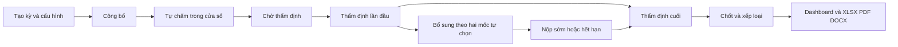

# Hệ thống đánh giá và xếp loại đơn vị

Ứng dụng gồm NestJS 11, PostgreSQL 16/Prisma 7 và React 19/Vite/Ant Design. ADMIN quản lý kỳ, tài khoản, tiêu chí, thẩm định và báo cáo; UNIT chỉ thao tác hồ sơ của đơn vị mình. Không đăng ký công khai. Dữ liệu và quyền lấy từ backend thật; chỉ bật MSW khi phát triển fixture riêng.

## Luồng nghiệp vụ



Mọi cửa sổ dùng `[start,deadline)`, backend quyết định bằng giờ server/DB UTC, hiển thị giờ Việt Nam. Admin chọn cả hai mốc bổ sung, gồm cuối tuần; không bắt đủ bảy ngày. Một vòng bổ sung, chỉ sửa đúng mục yêu cầu và khóa ngay khi nộp/hết hạn. Lịch đã gửi không đổi bởi retry. Bốn rating có cận phần trăm theo kỳ, mặc định 85/65/50/0; khóa cấu hình sau công bố.

## Cài đặt local

Cần Node.js 22.13+ hoặc 24, npm, PostgreSQL 16 và Docker khi chạy ma trận hệ thống. Giữ lockfile; dùng `npm ci`.

1. Sao chép [mẫu BE](./be/.env.example) thành `be/.env` và [mẫu FE](./fe/.env.example) thành `fe/.env`. Không ghi đè cấu hình hiện hữu. Điền DATABASE_URL, JWT_SECRET ngẫu nhiên ít nhất 32 ký tự và origin chính xác. Giữ provider ngoài tắt cho đến khi được cấu hình chủ động.
2. Chạy các lệnh sau từ thư mục repository:

```powershell
npm ci --prefix be
npm ci --prefix fe
npm run db:generate --prefix be
npm run db:validate --prefix be
npm run db:migrate:deploy --prefix be
npm run db:seed:base --prefix be
npm run start:dev --prefix be
# Terminal khác
npm run dev --prefix fe
```

`db:seed` cũng trỏ tới seed base, chỉ tạo Admin nếu chưa có. Bắt buộc SEED_ADMIN_PASSWORD riêng; lần đăng nhập đầu phải đổi mật khẩu. Seed base chạy lại không sửa tài khoản hiện hữu. Mật khẩu mới tối thiểu tám ký tự có chữ và số, khác username/mật khẩu cũ và không phổ biến.

Demo riêng: đặt `SEED_DEMO_ENABLED=true`, `SEED_LIVE_PERIODS=true`, NODE_ENV khác production, `STORAGE_PROVIDER=local`, STORAGE_LOCAL_DIR trỏ kho riêng và SEED_CREDENTIALS_FILE trỏ tệp private rồi chạy `npm run db:seed:demo --prefix be`. Seed tạo 34 đơn vị, hai kỳ lịch sử và hai kỳ live (nháp/chờ mở sau hai phút), đủ trạng thái và bốn mức rating, minh chứng PDF/PNG/DOCX do nhóm tự tạo. UNIT mới dùng INITIAL_ACCOUNT_PASSWORD (demo 123456), buộc đổi lần đầu. Chạy lại giữ hồ sơ và lịch/ngưỡng của kỳ đã có. Không seed demo trên dữ liệu thật; không chạy seed trong startup. `db:reset` có guard: chỉ DB local tên `seminar_demo[_hậu_tố]`, NODE_ENV khác production, ALLOW_DEMO_RESET=true, RESET_DEMO_DATABASE và `--database=<tên>` trùng đích. Không dùng nó cho DB đang có người sử dụng; seed demo là bước riêng sau reset.

Swagger local ở `/api/docs`, JSON ở `/api/docs-json`. Production tắt Swagger và công cụ scheduler thủ công. [Contract](./docs/API_CONTRACT.md), [danh sách API](<./docs/danh sách api.md>) và [schema](./be/prisma/schema.prisma) mô tả giao ước hiện hành.

## Hướng dẫn sử dụng

- ADMIN → Quản lý tài khoản: tạo lẻ hoặc Import Excel. “Tạo danh sách Excel” sinh 1–100 dòng văn bản có số thứ tự/tiền tố/mẫu tên/domain/loại đơn vị. Tải để sửa hoặc dùng bản nháp, sau đó preview → confirm. Preview chưa tạo tài khoản. Kiểm đúng người nhận trước khi xác nhận gửi Email.
- ADMIN → Cấu hình: tạo kỳ/năm, mốc tự chấm, cây tiêu chí và bốn ngưỡng. Tổng lá phải khớp tổng kỳ; kiểm điều kiện rồi công bố. Mỗi năm một kỳ; thay ngưỡng chỉ trước công bố.
- UNIT → Hồ sơ: nhập điểm/diễn giải, upload hoặc link minh chứng, lưu nháp rồi nộp. PDF/ảnh xem tại chỗ; Word tải về. Giữ nháp khi lỗi và xem thông báo server về quyền/hạn.
- ADMIN → Hồ sơ: so tự chấm/thẩm định, ghi lý do khi giảm điểm, hoàn tất lượt đầu. Chọn mục và ghi chú, chọn hai mốc giờ Việt Nam, xem trước rồi gửi bổ sung. Sau nộp/hết hạn, tiếp tục thẩm định cuối và xác nhận chốt.
- Dashboard đọc dữ liệu thật của kỳ đã chọn; báo cáo XLSX tổng hợp và PDF/DOCX biên bản được backend tạo, tải qua URL ngắn hạn kèm phiên ADMIN. Báo cáo và audit không chứa key kho hoặc credential.

## Kiểm thử

```powershell
npm run lint --prefix be
npm run build --prefix be
npm run test:unit --prefix be
npm run lint --prefix fe
npm test --prefix fe
npm run build --prefix fe
```

Bộ [VC17](./docs/VC17_KIEM_THU.md) cần PostgreSQL local mới tên `vc17_control_test` và Mailpit ở 1025/8025, Chromium (`npx playwright install chromium` trong BE). Chỉ định VC17_ADMIN_DATABASE_URL rồi chạy `npm run test:vc17 --prefix be`. Runner tạo DB mới cho mỗi suite và từ chối DB đã tồn tại; không reset dữ liệu. Mặc định gồm unit, ba TZ, HTTP/PG, upgrade/race, tải, hai vai trò browser và coverage. Chọn VC17_SUITES chỉ khi chẩn đoán; ghi rõ phần đã chọn.

Kiểm Supabase thật: chỉ định project/service key trong môi trường BE và `VC10_SUPABASE_BUCKET` là bucket private dành kiểm thử, build BE rồi chạy `npm run test:supabase --prefix be`. Script kiểm ACL, upload/download bytes và dọn đúng object UUID của lượt kiểm; báo cáo local không chứa secret. Đây là kiểm provider, cần kết hợp ma trận quyền HTTP/browser để nghiệm thu tích hợp đầy đủ.

## Sửa validation và đo tải 1.000 người (28/11/2026)

Cảnh báo sắp hết hạn của tự chấm và bổ sung dùng cùng một quy tắc ở hồ sơ và scheduler: thời gian nhắc trước hạn = `min((kết thúc - bắt đầu) / 2, 24 giờ)`. Ví dụ 10 phút → nhắc khi còn 5 phút, 30 phút → 15 phút, 2 giờ → 1 giờ, từ 48 giờ → còn 24 giờ. Không nhắc trước cửa sổ hoặc sau khi nộp/hết hạn. Hộp thư được scheduler quét mỗi phút; hồ sơ UNIT đang mở được polling mỗi 15 giây, nên thông báo có độ trễ tương ứng nhịp quét.

Form lưu kỳ chặn thời gian bắt đầu không còn ở tương lai, API kiểm lại theo giờ server cả khi tạo/sửa (kể cả PATCH ghép với lịch đã lưu). Nháp vẫn được để trống lịch. Form và API tiêu chí chặn điểm con vượt cha, tổng con trực tiếp vượt cha, giảm điểm cha xuống dưới tổng con và chuyển nhánh sang cha không đủ điểm. Trong lúc cấu hình, tổng con được nhỏ hơn cha; điều kiện bằng nhau vẫn được kiểm khi công bố.

Repo trước đây chỉ có bài tải nhẹ 34 người ở VC17. Bộ [fixture](./be/scripts/load-test-fixture.mjs) và [kịch bản k6](./be/test/load/workload.k6.js) bổ sung 1.000 danh tính UNIT riêng, cùng một kỳ, tăng tải 100 → 250 → 500 → 1.000 và giữ 1.000 trong ba phút. Mỗi VU nghỉ 1–3 giây giữa thao tác; 80% đọc hồ sơ/tổng điểm/chuông, 20% lưu điểm. Đây là phiên đã xác thực, gọi NestJS và PostgreSQL thật với dữ liệu giả; không dùng MSW trả 200 giả để suy ra sức chịu tải. Fixture tạo JWT test đúng issuer/audience và guard vẫn đọc tài khoản thật trong DB. Bài này chưa đo login, upload, công bố 1.000 hồ sơ, báo cáo hoặc tốc độ render trình duyệt.

Chốt tiêu chí trước khi chạy: tỷ lệ lỗi <1%, p95 đọc <800 ms, p95 ghi <1.500 ms; `load:verify` phải xác nhận đủ mọi người đã lưu đúng hồ sơ/điểm. p95 là thời gian mà 95% request hoàn tất trong đó. k6 xuất RPS, p90/p95, tỷ lệ lỗi; thu thêm CPU/RAM của BE/DB, số connection và lock wait/slow query để giải thích giới hạn. 1.000 tài khoản trong DB khác với 1.000 người hoạt động đồng thời; bài ramping VU cũng không tương đương 1.000 request đến đúng một thời điểm. Với bài đo này, dữ liệu giả có ba tiêu chí; lượt nghiệm thu nên bổ sung cây và lịch sử đủ lớn như thực tế.

Chạy từ thư mục repository trong **PowerShell riêng**, cần Docker đang chạy và k6 đã cài. Dùng DB/container mới, không dùng DB dev/production đang có người thao tác. Không ghi đè cấu hình hiện có; các biến dưới chỉ tồn tại trong terminal kiểm tải:

```powershell
$env:NODE_ENV = 'test'
$env:LOAD_DB_PASSWORD = node -e "process.stdout.write(require('node:crypto').randomBytes(24).toString('hex'))"
$env:JWT_SECRET = node -e "process.stdout.write(require('node:crypto').randomBytes(32).toString('hex'))"
$env:JWT_ISSUER = 'seminar'
$env:JWT_AUDIENCE = 'seminar-client'
$env:LOAD_TEST_DATABASE_URL = "postgresql://seminar_load:$($env:LOAD_DB_PASSWORD)@127.0.0.1:5544/seminar_load_test"
$env:DATABASE_URL = $env:LOAD_TEST_DATABASE_URL
$env:PORT = '3001'
$env:WEB_ORIGINS = 'http://127.0.0.1:5173'
$env:CORS_ORIGINS = 'http://127.0.0.1:5173'
$env:PUBLIC_APP_URL = 'http://127.0.0.1:5173'
$env:EMAIL_ENABLED = 'false'
$env:WEB_PUSH_ENABLED = 'false'
$env:ZALO_ZNS_ENABLED = 'false'
$env:STORAGE_ENABLED = 'false'
$env:STORAGE_PROVIDER = 'local'
$env:STORAGE_LOCAL_DIR = 'be/.tmp/load-test/storage'
$env:REPORT_EXPORT_PROVIDER = 'local'
$env:REPORT_EXPORT_DIR = 'be/.tmp/load-test/reports'
$env:RATE_LIMIT_ENABLED = 'true'
$env:LOAD_TEST_BASE_URL = 'http://127.0.0.1:3001'
docker run --name seminar-load-postgres -e POSTGRES_USER=seminar_load -e POSTGRES_PASSWORD=$env:LOAD_DB_PASSWORD -e POSTGRES_DB=seminar_load_test -p 127.0.0.1:5544:5432 -d postgres:16
# Chờ pg_isready báo accepting connections trước khi chạy migration
docker exec seminar-load-postgres pg_isready -U seminar_load -d seminar_load_test
npm run db:migrate:deploy --prefix be
npm run build --prefix be
npm run load:seed --prefix be
node be/dist/main.js
```

Trong terminal khác, chạy smoke trước, rồi bài 1.000 VU. Fixture có phiên/hạn hai giờ và chỉ trỏ backend local đã chỉ định. Lưu kết quả trước/sau thay đổi với cùng cấu hình máy, commit và dữ liệu; muốn chạy lượt mới hoàn toàn thì dùng DB mới và lưu fixture/kết quả lượt cũ riêng. Script không tự reset DB hay ghi đè fixture.

```powershell
k6 run -e TARGET_VUS=5 -e RAMP_DURATION=2s -e HOLD_DURATION=15s --summary-export=be/.tmp/load-test/smoke.json be/test/load/workload.k6.js
k6 run --out json=be/.tmp/load-test/timeseries-1000.json --summary-export=be/.tmp/load-test/summary-1000.json be/test/load/workload.k6.js
# Ở terminal đã đặt LOAD_TEST_DATABASE_URL và NODE_ENV=test, sau lượt 1.000 VU:
npm run load:verify --prefix be
docker stats --no-stream seminar-load-postgres
```

`be/.tmp/load-test/users.json` chứa token private, không chia sẻ/commit. Chỉ chia sẻ summary và kết quả integrity đã bỏ credential. Kết quả smoke 5 người không đủ để chạy `load:verify` cho bộ 1.000 danh tính; phải hoàn tất lượt 1.000. Kết quả local chưa đại diện cho máy triển khai, proxy/HTTPS hay độ trễ người dùng thật. Với máy phát tải riêng, chạy một bản môi trường test tương đương và điều chỉnh quy trình cấp fixture/đích có chủ đích, không dùng token test trên production.

Hướng tối ưu dựa trên source hiện tại (cần đo trước/sau, chưa phải kết luận đã chịu được 1.000 người):

- Ưu tiên đo `lockPeriod`: các thao tác đọc/lưu hồ sơ đang lấy `FOR UPDATE` trên cùng kỳ rồi khóa hồ sơ, dễ tuần tự hóa cả 1.000 đơn vị. Thiết kế lại khóa đọc/chia sẻ cấu hình kỳ và khóa riêng hồ sơ, giữ khóa độc quyền cho thay lịch/giai đoạn. Phải kiểm lại race công bố, deadline và scheduler trước khi thay đổi cơ chế khóa.
- Giảm dữ liệu và query của từng lần lưu: hiện context tải cây, mọi điểm và minh chứng; tách truy vấn/response chỉ cho lá đang lưu. UNIT đang polling hồ sơ mỗi 15 giây: 1.000 phiên riêng polling đã khoảng 67 vòng tải/giây, mỗi vòng còn có nhiều request; cân nhắc tăng nhịp, backoff khi tab ẩn hoặc cập nhật theo thay đổi.
- Đọc `EXPLAIN (ANALYZE, BUFFERS)`, lock wait và pool queue để chọn index hoặc chỉnh pool/PgBouncer; không tăng số connection mù quáng. Giữ API phân trang; cache dữ liệu cấu hình đã công bố và aggregate có invalidation/quyền rõ ràng.
- Khi CPU/query đã được xử lý mới cân nhắc nhiều replica, dùng store rate limit chung (hiện store nằm trong process), kiểm worker/scheduler và chuyển công việc nặng xuất báo cáo/thông báo sang hàng đợi. FE dùng bản build qua Nginx/CDN. Test upload/report/login riêng, giữ giới hạn login: 1.000 login từ cùng IP sẽ gặp 429 theo thiết kế, không coi đó là phép đo năng lực toàn hệ thống.
- Để báo cáo cho giảng viên: ghi cấu hình máy + commit, mô hình tải, bảng từng mức VU với RPS/p95/lỗi/CPU/RAM/lock wait, biểu đồ trước/sau và kết quả kiểm dữ liệu. Nếu không đạt ở 1.000, báo mức đạt cao nhất cùng lỗi/nút nghẽn đo được và chạy lại cùng bài sau tối ưu.

## Docker và HTTPS (triển khai)

[Compose triển khai](./deploy/compose.yml) gồm PostgreSQL, migration riêng, cấp quyền DB app, BE, FE Nginx và Caddy. DB không mở port ra host; chỉ proxy mở HTTP/HTTPS. Runtime chạy user node và role `seminar_app` không superuser, không UPDATE/DELETE/TRUNCATE audit/history. Migration dùng role owner riêng và hoàn tất trước BE nhận request.

Sao chép [mẫu cấu hình triển khai](./deploy/.env.example) thành `deploy/.env`. Tạo POSTGRES_PASSWORD, DB_APP_PASSWORD, JWT_SECRET và INITIAL_ACCOUNT_PASSWORD bằng chuỗi ngẫu nhiên riêng (hex giúp URL DB hợp lệ). Điền APP_HOST/domain và DNS tới máy chủ, mở 80/443; production giữ RUNTIME_ENV=production, HTTPS, SWAGGER_ENABLED=false và ZNS tắt. Caddy tự quản lý chứng chỉ; localhost dùng CA local, cần tin cậy CA trên thiết bị khi thử Push. Cấu hình PostgreSQL/NTP host ở UTC, không sửa giờ hệ thống để demo.

```powershell
docker compose --env-file deploy/.env -f deploy/compose.yml config --quiet
docker compose --env-file deploy/.env -f deploy/compose.yml up -d --build --wait
# Seed có chủ đích; đặt SEED_ADMIN_PASSWORD trong deploy/.env trước khi chạy
docker compose --env-file deploy/.env -f deploy/compose.yml run --rm seed
```

Với demo local có file: RUNTIME_ENV=development, STORAGE_ENABLED=true, STORAGE_PROVIDER=local. Demo seed cần thêm SEED_DEMO_ENABLED=true và chạy `docker compose --env-file deploy/.env -f deploy/compose.yml run --rm seed npx tsx prisma/seed.ts`. Production dùng bucket Supabase private và service key BE; không đưa key vào FE. Compose mặc định tắt Email/Push/ZNS; để gửi thật phải cấu hình các biến tương ứng từ mẫu BE, khóa AES/VAPID và kiểm đúng người nhận. ZNS là tùy chọn chưa kích hoạt, không yêu cầu gửi thật khi demo.

HTTP runtime có rate limit riêng login/IP/username, refresh, onboarding, import, upload và retry. AUTH/credential không cache; JSON 1 MiB, Excel 5 MiB, minh chứng 10 MiB. TRUST_PROXY mặc định không tin proxy; Compose chỉ tin mạng container riêng. Bộ đếm hiện dành một replica, cần store chung nếu mở rộng. Log requestId/method/status/duration, không URL/header/body/secret. Health `/api/v1/health` kiểm DB; dùng `docker compose ... ps` và log để theo dõi, không xuất env ra báo cáo.

## Backup, restore và rollback

[Script backup/restore](./deploy/backup-restore.mjs) dừng BE ngắn để chụp DB cùng volume private, lưu pg_dump custom, file và checksum tất cả bảng. Thư mục backup chứa dữ liệu riêng, cần mã hóa/giới hạn truy cập ngoài máy demo. Bucket Supabase cần backup object riêng theo namespace và đối chiếu với DB snapshot; script local không bao gồm bucket thật.

```powershell
node deploy/backup-restore.mjs backup seminar-demo deploy/.env deploy/backups/buoi-demo
# Sao chép env sang deploy/.env.restore, đặt port riêng và cùng cấu hình dữ liệu phù hợp
node deploy/backup-restore.mjs restore seminar-restore-rehearsal deploy/.env.restore deploy/backups/buoi-demo
```

Restore chỉ chấp nhận project mới `seminar-restore-*` và DB trống, đối chiếu checksum rồi khởi động BE/FE/proxy. Không reset DB nguồn. Kiểm login/me, hồ sơ, minh chứng, báo cáo và provider được bật sau restore. Trước release lưu RELEASE_TAG/ảnh Docker và backup; rollback về ảnh trước chỉ khi schema tương thích, không chạy migrate reset/down trên DB thật. Khi migration không tương thích, phục hồi DB/bucket snapshot sang môi trường mới và đổi traffic sau kiểm smoke. Giữ credential/JWT/khóa mã hóa ngoài backup Git và giữ key cũ cần giải mã outbox khi khôi phục.

## Kết quả kiểm và giới hạn

[Biên bản hoàn thiện 24/11](./docs/HOAN_THIEN_2026-11-24.md) ghi test, browser, HTTPS và restore đã kiểm cùng phần cần môi trường thật.

## Bàn giao và diễn tập

Xem [kịch bản nghiệm thu](./docs/DEMO_NGHIEM_THU.md), [slide trình chiếu](./docs/bao-ve.html) và [slide PDF](./docs/BAO_VE_DO_AN.pdf). Các bằng chứng lịch sử nằm trong tài liệu VC tương ứng; kết quả local chỉ xác nhận bản/DB đã kiểm. Chỉ đóng Supabase, triển khai public, Email/Push thật và hai lần diễn tập trên URL bảo vệ sau khi có môi trường/thiết bị được chỉ định và kết quả thực tế.
